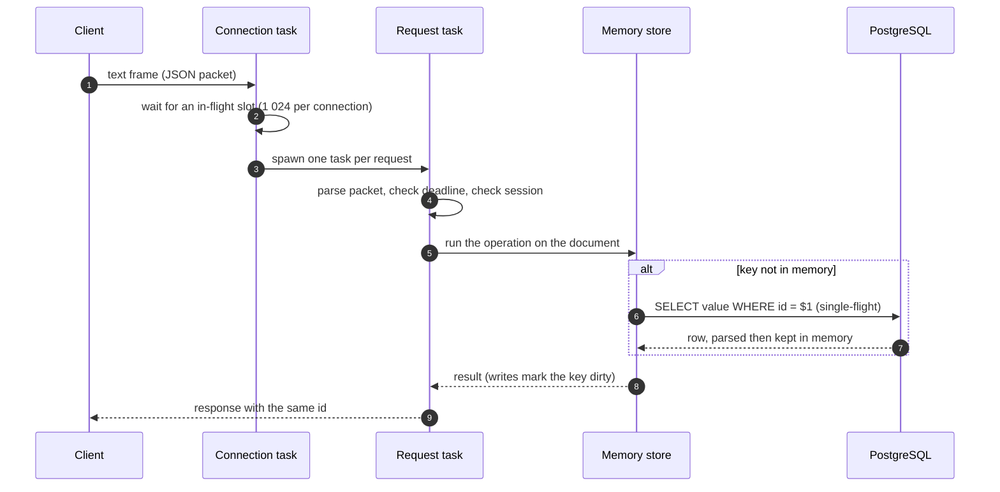
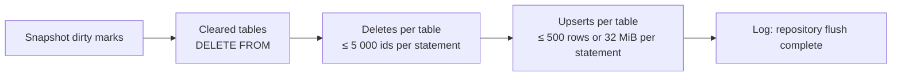
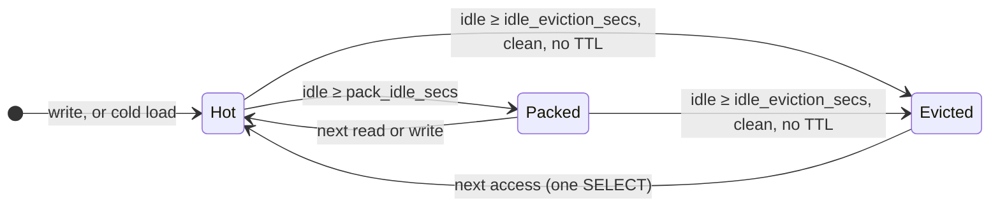

# Architecture

HorizonDB is one process with three layers: a WebSocket front, an in-memory
document store, and PostgreSQL behind it. Requests only ever touch the first
two; PostgreSQL is reached for keys that are not in memory yet and by the
periodic flush.

```text
  client ──ws──▶ ┌───────────────────────────────────────────────┐
                 │  memory      ☀  documents, sessions, TTL keys │
  client ──ws──▶ │              ≡  per-key locks, dirty marks    │
                 ├───────── flush every N s, and on shutdown ────┤
                 │  PostgreSQL  ▭  one table per namespace       │
                 └───────────────────────────────────────────────┘
```

## Data model { #data-model }

- A **table** is a namespace. Its name must match `[A-Za-z_][A-Za-z0-9_]{0,62}`
  (checked before any SQL is built) and defaults to `json`. Each table is a
  PostgreSQL table created on first use:

    ```sql
    CREATE TABLE IF NOT EXISTS "<table>" (id VARCHAR(255) PRIMARY KEY, value TEXT)
    ```

- A **key** such as `guild.42.settings.prefix` is split on dots. The first
  segment (`guild`) is the **base key**: one row, one JSON document. The rest
  (`42.settings.prefix`) is a **path** inside that document.
- `value` holds the whole document serialized as JSON text.

So `set("guild.42.settings.prefix", "!")` and `add("guild.42.stats.messages")`
edit the same row, `guild`. Choose base keys with that in mind: every write
anywhere in a document marks the whole document dirty and the flush rewrites
the whole row.

## Request lifecycle { #request-lifecycle }



1. **Accept.** A connection takes one of `server.max_connections` permits or is
   dropped on the spot. The WebSocket handshake applies `max_message_size` to
   both messages and frames.
2. **Read loop.** Each text frame takes one of 1 024 in-flight slots for that
   connection. When all are taken the server stops reading the socket until
   responses drain, which turns into TCP backpressure for the client instead
   of unbounded task growth. Binary frames are ignored.
3. **One task per request.** Requests on the same connection run concurrently,
   so a slow `all` never blocks unrelated `get`s. Responses can therefore come
   back **out of order**: clients correlate them by `id`.
4. **Deadline.** If the request already waited longer than its `timeoutMs`
   (10 s when absent) since it was read, it is answered with
   `deadline exceeded` without being executed.
5. **Session.** Every operation except `login` and `logout` needs a valid
   `sessionId`.
6. **Operation.** The handler runs against the memory store and answers.
   Writes mark the key dirty and return immediately; nothing waits for
   PostgreSQL.

## Locks and concurrency { #locks }

Three levels of locking keep the hot path short:

| Lock | Scope | Held for |
| --- | --- | --- |
| Store lock (`RwLock`) | the `table → key → entry` maps | map lookups and inserts only, never while a document is read or copied |
| Entry lock (`RwLock`, one per document) | one document | readers copy the part they need; writers edit in place |
| Write lock (256 sharded mutexes, hashed by table and key) | all writers of one key | the whole read-modify-write of `set`, `add`, `push`, `delete`, `cache`… |

- **Reads** (`get`, `has`) take only the entry's read lock and copy the
  addressed sub-tree. A nested `get` on a multi-megabyte document copies a few
  bytes, not the document.
- **Read-modify-write** operations take the key's write lock, so two `add`s on
  the same counter can never interleave: no lost updates, no retries, no row
  locks. Two different keys only wait for each other when they hash to the
  same one of the 256 shards.
- A failed mutation (for example `add` on a string) leaves the document
  untouched: every operation validates its target before it changes
  anything. A mutation on a key that does not exist works on a detached entry
  that only becomes visible once it succeeded, so a failed `push` never leaves
  an empty placeholder behind.

## Cold loads { #cold-loads }

Keys are loaded lazily. The first access to a key that is not in memory:

1. checks the dirty tracker: a key deleted since the last flush, or in a table
   cleared since the last flush, is reported absent without asking
   PostgreSQL (the old row is still there until the flush removes it);
2. takes a **per-key load lock** (single-flight): concurrent misses on the same
   key share one `SELECT` and one parse;
3. runs `SELECT value FROM "<table>" WHERE id = $1` on the pool;
4. parses the JSON, on the blocking thread pool when it is 256 KiB or larger,
   so a big document cannot stall a runtime worker;
5. inserts the entry, unless a concurrent write already created one (the entry
   in memory always wins).

Mutations warm the document **before** taking the write lock, so a slow cold
load does not hold up other keys hashed to the same shard.

## Write-behind and dirty tracking { #write-behind }

Every write updates memory and records a **dirty mark**:

| Mark | Set by | Flushed as |
| --- | --- | --- |
| upsert | `set`, `add`, `sub`, `push`, `pull`, nested `delete`, `cache` | `INSERT … ON CONFLICT (id) DO UPDATE` |
| delete | top-level `delete`, a nested `delete` that empties the document, TTL expiry | `DELETE … WHERE id = ANY(…)` |
| table cleared | `deleteAll` | `DELETE FROM "<table>"` |

A later mark replaces an earlier one on the same key (an upsert after a delete
cancels the delete, and vice versa).

### Generations { #generations }

Each mark carries the **generation** it was made in. A flush:

1. takes a snapshot of every mark and bumps the generation;
2. writes the snapshot to PostgreSQL;
3. after each successful statement, forgets the marks of that statement **only
   if they are not newer than the snapshot**.

A write that lands while a flush is running carries the new generation, so it
stays dirty for the next cycle instead of being forgotten with the batch it
raced. A statement that fails leaves its own rows (and the ones after it)
dirty for the next cycle; the statements that succeeded are not replayed.

## Flush batching { #flush }

Every `flush_interval_secs` (the first flush happens one interval after
startup), the flush runs, in order:



| Limit | Value |
| --- | --- |
| Rows per `INSERT … SELECT * FROM UNNEST($1::text[], $2::text[])` | 500 |
| Payload per `INSERT` (soft bound) | 32 MiB |
| Ids per `DELETE … WHERE id = ANY($1::text[])` | 5 000 |

The upsert payload is the **current** in-memory value of each dirty key at the
time it is serialized (a packed document is sent as its stored text, without
being parsed). A key that was deleted or expired in the meantime is turned
into a delete mark instead. The flush yields to the runtime every 32
documents so a large batch cannot monopolize a worker.

A failed flush is logged (`repository flush failed, will retry next cycle`)
and retried at the next interval. Statements run one after another on the
pool; a flush never runs twice at the same time.

## Memory tiers { #memory-tiers }

Without a policy, every document ever read since startup would stay in memory
as a parsed `serde_json` tree, which costs roughly ten times the size of its
JSON text. A sweep that runs **every minute** keeps memory proportional to the
working set instead. Each document is in one of three tiers:

| Tier | Form | Cost of the next access |
| --- | --- | --- |
| **Hot** | parsed JSON tree, edited in place | none |
| **Packed** | compact JSON text, still in memory | parse back in place: ~4 µs for a 1 KB document, ~7 ms for an 870 KB one; no PostgreSQL |
| **Evicted** | only in PostgreSQL | one `SELECT` plus a parse (a [cold load](#cold-loads)) |



Each sweep, for every document whose lock is free:

1. **Expired TTL keys** are removed and marked for deletion in PostgreSQL.
2. **Eviction.** A document idle for at least `idle_eviction_secs` leaves
   memory **if it is clean** (no pending upsert, its table not pending a
   clear) **and has no TTL**. The check runs under the key's write lock, so a
   write cannot slip in between the check and the removal. A dirty candidate
   stays and is packed instead; it becomes evictable after the next flush.
3. **Packing.** A document idle for at least `pack_idle_secs` is serialized to
   compact JSON text on the blocking pool and its tree is freed. Only objects
   and arrays are packed: scalars are already compact.

"Idle" means neither read nor written: `get`, `has` and every mutation refresh
a document's clock; the flush and `all` scans read packed text directly and
do not.

After a sweep that removed entries, key maps using less than a quarter of
their capacity are shrunk, because a hash map never returns the space of
removed entries on its own. **jemalloc** is the global allocator: its
background threads return freed pages to the operating system on a decay
timer, even while the process is idle, where the system allocator would keep
them in its arenas.

!!! info "What TTL keys never do"

    A key written with `cache` stays in memory until it expires: its deadline
    lives only in memory, so evicting and reloading it would make it permanent.
    It can still be packed.

Measured on this branch (200 000 documents of about 1 KB, 185 MB of JSON):
a parsed document costs about **11.2 KB** in memory, the packed form about
**1.0 KB**; the resident memory drops from **2 703 MiB** (no policy, forever) to
**60 MiB** once idle with eviction. Full numbers on the
[Benchmarks](benchmarks.md#memory) page.

## Sessions { #sessions }

Sessions are random UUIDs kept in memory, mapped to the time of their last
activity. Verifying one only takes a read lock (the timestamp is an atomic),
so thousands of concurrent requests never serialize on a writer. Expired
sessions are refused on use and purged every five minutes. Sessions are not
persisted: **a restart invalidates all of them** and clients log in again (the
SDK does it automatically).

## Durability { #durability }

!!! warning "Durability is a trade you choose"

    Until the next flush, writes live **only in memory**. A crash, an OOM kill
    or a `kill -9` loses up to `flush_interval_secs` of acknowledged writes
    (300 s by default). SIGINT and SIGTERM flush everything before exiting,
    within a 10-second budget (see [graceful shutdown](operations.md#shutdown)).

    Lower `flush_interval_secs` if that window is too wide for your data. A
    shorter interval means more, smaller flushes; each flush rewrites the
    whole document of every dirty key.

Other consequences of write-behind worth knowing:

- **PostgreSQL lags behind memory.** Reading the tables directly shows the
  state of the last flush, not the current one.
- **Do not edit the tables while the server runs.** A document already in
  memory keeps being served from memory, and if it is dirty the next flush
  overwrites your edit. Stop the server, edit, start again.
- **One server per set of tables.** Instances do not coordinate; two servers
  sharing tables would serve and overwrite each other's stale copies.
- **TTLs are memory-only.** A `cache` key is flushed like any other write,
  without its deadline. If the server restarts before the key expires, it
  comes back from PostgreSQL as a permanent key.
