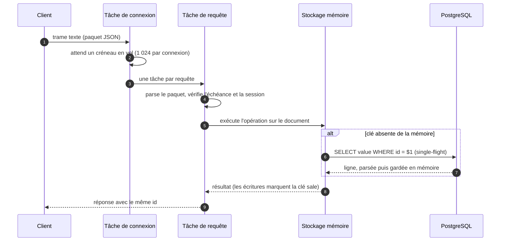
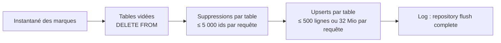
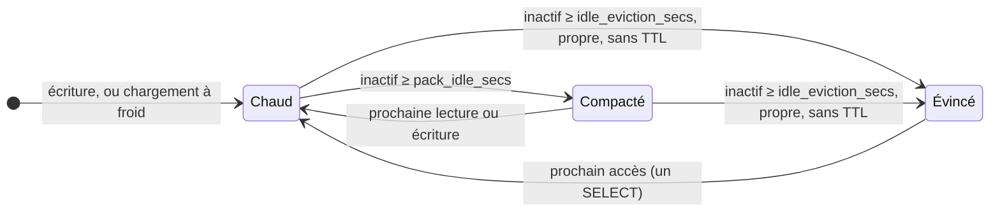

# Architecture

HorizonDB est un seul processus en trois couches : une façade WebSocket, un
stockage de documents en mémoire, et PostgreSQL derrière. Les requêtes ne
touchent que les deux premières ; PostgreSQL n'est sollicité que pour les clés
pas encore en mémoire et par le flush périodique.

```text
  client ──ws──▶ ┌───────────────────────────────────────────────┐
                 │  mémoire     ☀  documents, sessions, clés TTL │
  client ──ws──▶ │              ≡  verrous par clé, marques sales│
                 ├──────── flush toutes les N s, et à l'arrêt ───┤
                 │  PostgreSQL  ▭  une table par espace de noms  │
                 └───────────────────────────────────────────────┘
```

## Modèle de données { #data-model }

- Une **table** est un espace de noms. Son nom doit respecter
  `[A-Za-z_][A-Za-z0-9_]{0,62}` (vérifié avant de construire la moindre requête
  SQL) et vaut `json` par défaut. Chaque table est une table PostgreSQL créée
  à sa première utilisation :

    ```sql
    CREATE TABLE IF NOT EXISTS "<table>" (id VARCHAR(255) PRIMARY KEY, value TEXT)
    ```

- Une **clé** comme `guild.42.settings.prefix` est découpée sur les points. Le
  premier segment (`guild`) est la **clé de base** : une ligne, un document
  JSON. Le reste (`42.settings.prefix`) est un **chemin** dans ce document.
- `value` contient le document entier sérialisé en JSON texte.

Ainsi `set("guild.42.settings.prefix", "!")` et `add("guild.42.stats.messages")`
modifient la même ligne, `guild`. Choisissez vos clés de base en conséquence :
toute écriture n'importe où dans un document marque le document entier comme
sale, et le flush réécrit la ligne entière.

## Cycle de vie d'une requête { #request-lifecycle }



1. **Acceptation.** Une connexion prend un des `server.max_connections` jetons,
   ou est fermée sur-le-champ. Le handshake WebSocket applique
   `max_message_size` aux messages comme aux trames.
2. **Boucle de lecture.** Chaque trame texte prend un des 1 024 créneaux en vol
   de la connexion. Quand ils sont tous pris, le serveur cesse de lire le
   socket jusqu'à ce que des réponses partent : le client subit une
   contre-pression TCP au lieu d'une multiplication sans fin des tâches. Les
   trames binaires sont ignorées.
3. **Une tâche par requête.** Les requêtes d'une même connexion s'exécutent en
   parallèle : un `all` lent ne bloque jamais des `get` sans rapport. Les
   réponses peuvent donc revenir **dans le désordre** : les clients les
   associent par `id`.
4. **Échéance.** Si la requête a déjà attendu plus que son `timeoutMs` (10 s
   s'il est absent) depuis sa lecture, elle reçoit `deadline exceeded` sans
   être exécutée.
5. **Session.** Toutes les opérations sauf `login` et `logout` exigent un
   `sessionId` valide.
6. **Opération.** Le handler travaille sur le stockage en mémoire et répond.
   Les écritures marquent la clé comme sale et répondent aussitôt ; rien
   n'attend PostgreSQL.

## Verrous et concurrence { #locks }

Trois niveaux de verrous gardent le chemin chaud court :

| Verrou | Portée | Tenu pendant |
| --- | --- | --- |
| Verrou du stockage (`RwLock`) | les tables `table → clé → entrée` | les recherches et insertions uniquement, jamais pendant la lecture ou la copie d'un document |
| Verrou d'entrée (`RwLock`, un par document) | un document | les lecteurs copient ce dont ils ont besoin ; les écrivains modifient sur place |
| Verrou d'écriture (256 mutex répartis par hash de la table et de la clé) | tous les écrivains d'une clé | toute la lecture-modification-écriture de `set`, `add`, `push`, `delete`, `cache`… |

- Les **lectures** (`get`, `has`) ne prennent que le verrou de lecture de
  l'entrée et copient le sous-arbre visé. Un `get` imbriqué sur un document de
  plusieurs mégaoctets copie quelques octets, pas le document.
- Les opérations de **lecture-modification-écriture** prennent le verrou
  d'écriture de la clé : deux `add` sur le même compteur ne peuvent jamais
  s'entrelacer. Pas de mise à jour perdue, pas de nouvelle tentative, pas de
  verrou de ligne. Deux clés différentes ne s'attendent que si elles tombent
  sur le même des 256 mutex.
- Une mutation qui échoue (un `add` sur une chaîne, par exemple) laisse le
  document intact : chaque opération valide sa cible avant de modifier quoi
  que ce soit. Une mutation sur une clé inexistante travaille sur une entrée
  détachée, qui ne devient visible qu'en cas de succès : un `push` raté ne
  laisse jamais de document vide derrière lui.

## Chargements à froid { #cold-loads }

Les clés se chargent à la demande. Le premier accès à une clé absente de la
mémoire :

1. consulte le suivi des marques sales : une clé supprimée depuis le dernier
   flush, ou dans une table vidée depuis le dernier flush, est déclarée absente
   sans interroger PostgreSQL (l'ancienne ligne y est encore jusqu'à ce que le
   flush la supprime) ;
2. prend un **verrou de chargement par clé** (single-flight) : les accès
   simultanés à la même clé absente partagent un seul `SELECT` et un seul
   parsing ;
3. exécute `SELECT value FROM "<table>" WHERE id = $1` sur le pool ;
4. parse le JSON, sur le pool de threads bloquants dès 256 Kio, pour qu'un gros
   document ne paralyse pas un worker du runtime ;
5. insère l'entrée, sauf si une écriture concurrente en a déjà créé une
   (l'entrée en mémoire gagne toujours).

Les mutations chargent le document **avant** de prendre le verrou d'écriture :
un chargement à froid lent ne retient pas les autres clés du même mutex.

## Write-behind et marques sales { #write-behind }

Chaque écriture met à jour la mémoire et pose une **marque sale** :

| Marque | Posée par | Flushée sous forme de |
| --- | --- | --- |
| upsert | `set`, `add`, `sub`, `push`, `pull`, `delete` imbriqué, `cache` | `INSERT … ON CONFLICT (id) DO UPDATE` |
| suppression | `delete` de premier niveau, un `delete` imbriqué qui vide le document, expiration d'un TTL | `DELETE … WHERE id = ANY(…)` |
| table vidée | `deleteAll` | `DELETE FROM "<table>"` |

Une marque plus récente remplace la précédente sur la même clé (un upsert
après une suppression annule la suppression, et inversement).

### Générations { #generations }

Chaque marque porte la **génération** dans laquelle elle a été posée. Un
flush :

1. prend un instantané de toutes les marques et incrémente la génération ;
2. écrit l'instantané dans PostgreSQL ;
3. après chaque requête réussie, oublie les marques de cette requête
   **seulement si elles ne sont pas plus récentes que l'instantané**.

Une écriture qui arrive pendant un flush porte la nouvelle génération : elle
reste sale pour le cycle suivant au lieu d'être oubliée avec le lot qu'elle a
croisé. Une requête qui échoue laisse ses lignes (et les suivantes) sales pour
le cycle suivant ; celles qui ont réussi ne sont pas rejouées.

## Flush par lots { #flush }

Toutes les `flush_interval_secs` (le premier flush a lieu un intervalle après
le démarrage), le flush exécute, dans l'ordre :



| Limite | Valeur |
| --- | --- |
| Lignes par `INSERT … SELECT * FROM UNNEST($1::text[], $2::text[])` | 500 |
| Volume par `INSERT` (borne souple) | 32 Mio |
| Ids par `DELETE … WHERE id = ANY($1::text[])` | 5 000 |

Le contenu de chaque upsert est la valeur **actuelle** en mémoire de la clé au
moment où elle est sérialisée (un document compacté est envoyé tel quel, sans
être reparsé). Une clé supprimée ou expirée entre-temps devient une marque de
suppression. Le flush rend la main au runtime tous les 32 documents pour
qu'un gros lot ne monopolise pas un worker.

Un flush en échec est logué (`repository flush failed, will retry next cycle`)
et retenté à l'intervalle suivant. Les requêtes s'enchaînent une par une sur le
pool ; deux flushs ne tournent jamais en même temps.

## Niveaux de mémoire { #memory-tiers }

Sans politique, chaque document lu depuis le démarrage resterait en mémoire
sous forme d'arbre `serde_json` parsé, qui coûte environ dix fois la taille de
son JSON texte. Un balayage qui tourne **chaque minute** garde plutôt la
mémoire proportionnelle aux données actives. Chaque document se trouve à l'un
de trois niveaux :

| Niveau | Forme | Coût du prochain accès |
| --- | --- | --- |
| **Chaud** | arbre JSON parsé, modifié sur place | aucun |
| **Compacté** | JSON texte compact, toujours en mémoire | reparsing sur place : ~4 µs pour un document de 1 Ko, ~7 ms pour 870 Ko ; pas de PostgreSQL |
| **Évincé** | seulement dans PostgreSQL | un `SELECT` plus un parsing (un [chargement à froid](#cold-loads)) |



À chaque balayage, pour chaque document dont le verrou est libre :

1. Les **clés TTL expirées** sont retirées et marquées pour suppression dans
   PostgreSQL.
2. **Éviction.** Un document inactif depuis au moins `idle_eviction_secs`
   quitte la mémoire **s'il est propre** (pas d'upsert en attente, sa table pas
   en attente de vidage) **et sans TTL**. La vérification a lieu sous le verrou
   d'écriture de la clé : aucune écriture ne peut se glisser entre la
   vérification et le retrait. Un candidat sale reste, et il est compacté à la
   place ; il deviendra évinçable après le prochain flush.
3. **Compactage.** Un document inactif depuis au moins `pack_idle_secs` est
   sérialisé en JSON texte compact sur le pool bloquant, et son arbre est
   libéré. Seuls les objets et les tableaux sont compactés : les scalaires le
   sont déjà.

« Inactif » signifie ni lu ni écrit : `get`, `has` et toutes les mutations
remettent l'horloge du document à zéro ; le flush et les parcours `all` lisent
directement le texte compacté et ne la touchent pas.

Après un balayage qui a retiré des entrées, les tables de clés qui utilisent
moins du quart de leur capacité sont réduites, car une table de hachage ne
rend jamais d'elle-même la place des entrées supprimées. **jemalloc** est
l'allocateur global : ses threads d'arrière-plan rendent les pages libérées au
système selon une temporisation, même quand le processus est au repos, là où
l'allocateur système les garderait dans ses arènes.

!!! info "Ce que les clés TTL ne font jamais"

    Une clé écrite avec `cache` reste en mémoire jusqu'à son expiration : son
    échéance n'existe qu'en mémoire, l'évincer puis la recharger la rendrait
    permanente. Elle peut en revanche être compactée.

Mesuré sur cette branche (200 000 documents d'environ 1 Ko, 185 Mo de JSON) :
un document parsé coûte environ **11,2 Ko** en mémoire, sa forme compactée
environ **1,0 Ko** ; la mémoire résidente passe de **2 703 Mio** (sans
politique, pour toujours) à **60 Mio** une fois au repos avec l'éviction.
Tous les chiffres sont sur la page [Benchmarks](benchmarks.md#memory).

## Sessions { #sessions }

Les sessions sont des UUID aléatoires gardés en mémoire, associés à l'heure de
leur dernière activité. Vérifier une session ne prend qu'un verrou de lecture
(l'horodatage est atomique) : des milliers de requêtes simultanées ne se
sérialisent jamais derrière un écrivain. Les sessions expirées sont refusées à
l'usage et purgées toutes les cinq minutes. Elles ne sont pas persistées :
**un redémarrage les invalide toutes** et les clients se reconnectent (le SDK
le fait tout seul).

## Durabilité { #durability }

!!! warning "La durabilité est un compromis que vous choisissez"

    Jusqu'au prochain flush, les écritures ne vivent **qu'en mémoire**. Un
    crash, un OOM kill ou un `kill -9` perd jusqu'à `flush_interval_secs`
    d'écritures déjà confirmées (300 s par défaut). SIGINT et SIGTERM vident
    tout avant de quitter, dans un budget de 10 secondes (voir
    [arrêt propre](operations.md#shutdown)).

    Baissez `flush_interval_secs` si cette fenêtre est trop large pour vos
    données. Un intervalle plus court donne des flushs plus nombreux et plus
    petits ; chaque flush réécrit le document entier de chaque clé sale.

Autres conséquences du write-behind à connaître :

- **PostgreSQL est en retard sur la mémoire.** Lire les tables directement
  montre l'état du dernier flush, pas l'état courant.
- **Ne modifiez pas les tables pendant que le serveur tourne.** Un document
  déjà en mémoire continue d'être servi depuis la mémoire, et s'il est sale,
  le prochain flush écrase votre modification. Arrêtez le serveur, modifiez,
  redémarrez.
- **Un serveur par jeu de tables.** Les instances ne se coordonnent pas ; deux
  serveurs partageant des tables serviraient et écraseraient chacun les
  copies périmées de l'autre.
- **Les TTL n'existent qu'en mémoire.** Une clé `cache` est flushée comme
  n'importe quelle écriture, sans son échéance. Si le serveur redémarre avant
  qu'elle expire, elle revient de PostgreSQL comme une clé permanente.
